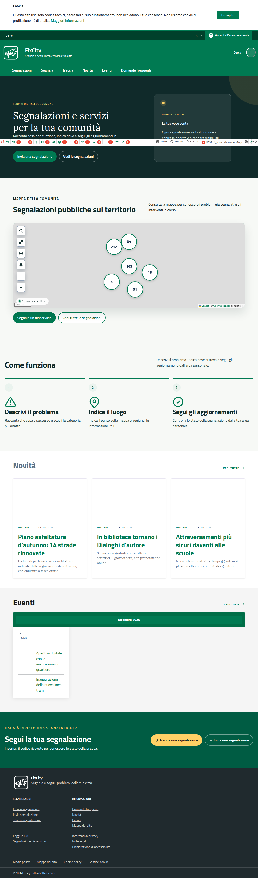

> Screenshot reale del front office attivo nel tenant di verifica, acquisito il 23 novembre 2026. Non viene usato per dichiarare che il tema TwentyOne è attivo: la resa specifica del tema resta quella documentata dal suo codice.

# Manuale d'uso degli attori

## Scopo

Questo manuale riassume gli attori e i flussi che il codice del tema TwentyOne dimostra. Non attribuisce al tema capacità che appartengono a User, Cms, Predict, Fixcity o Filament.

TwentyOne fornisce view, layout, pagine Folio/Volt, blocchi e navigazione. Le regole di autenticazione e autorizzazione sono delegate ai componenti e ai moduli che il tema richiama.

## Attori

### Ospite

È un visitatore non autenticato. Il codice del tema usa `Auth::guest()` e `@guest` per mostrare i collegamenti a registrazione e login. Può vedere le parti pubbliche del tema e viene indirizzato alle pagine di accesso quando un flusso lo richiede.

Non può usare le pagine che dichiarano middleware `auth`, come dashboard, profilo e verifica email.

### Autenticato

È l'utente restituito da `auth()`/`Auth`. Il tema mostra una navigazione diversa: profilo, wallet, menu utente e logout POST. Le pagine dashboard e profilo dichiarano `auth` e `verified`.

Il tema non dimostra quali dati l'utente possa leggere o modificare oltre alle operazioni presenti nelle singole view; la verifica deve restare nel modulo proprietario.

### Gruppo e team

Non è presente nel tema TwentyOne una regola autonoma che trasformi un gruppo/team in accesso a una pagina. L'eventuale appartenenza, il `team_id` e le autorizzazioni sono responsabilità del modello User, del sistema permessi e delle policy.

### Ruolo

Il tema non dichiara ruoli applicativi né implementa una matrice role-to-page. I ruoli sono gestiti dal modulo User e possono essere usati da Filament o dalle policy del dominio.

### Admin

Il tema contiene view per widget e interfacce Filament, ma non definisce da solo il perimetro dell'admin. URL, pannello, navigazione e autorizzazioni del back office sono proprietà di Filament e dei moduli registrati.

### Super-admin

TwentyOne non contiene una regola propria per il ruolo super-admin. Se un pannello o una pagina è riservata a quel ruolo, la decisione è presa da Xot/User e non dal markup del tema.

### Operatore

Il tema non contiene una definizione verificabile di operatore né una policy dedicata. Eventuali operatori del dominio devono essere documentati e autorizzati dal modulo che gestisce il dominio; TwentyOne ne può solo rappresentare il risultato.

## Flussi dimostrati dal codice

### Login e registrazione

TwentyOne ha pagine Folio per login, registrazione, verifica email, recupero password, reset password e logout. La registrazione dichiara `guest`, crea l'utente tramite il modello richiamato dalla view, effettua il login e reindirizza alla destinazione intended o alla home.

Il login usa il `LoginWidget` di User. I link a recupero password, registrazione e login sono renderizzati dalle view del tema e dalle relative traduzioni.

### Dashboard

`pages/dashboard/index.blade.php` dichiara `name('dashboard')` e middleware `auth` e `verified`. La pagina renderizza una dashboard Volt con layout `app`.

Questo dimostra l'esistenza della pagina e dei suoi prerequisiti tecnici, non che ogni utente autenticato abbia accesso a dati o funzioni ulteriori.

### Profilo

`pages/profile/edit.blade.php` dichiara `auth` e `verified`. La view carica l'utente autenticato, consente di proporre aggiornamenti a nome/email, cambiare password e richiedere la cancellazione dell'account, con controlli password nel componente.

La pagina non dimostra un'autorizzazione per modificare utenti diversi dall'utente corrente.

### Navigazione autenticata

Il tema usa `@guest`, `@auth` e `Auth::guest()` per alternare login/registrazione e menu autenticato. Nel menu autenticato sono presenti collegamenti a wallet, profilo e logout; alcune destinazioni sono costruite direttamente con il locale e il percorso `/pages/...`.

La presenza di un collegamento non sostituisce il middleware o la policy della destinazione.

### Pagine CMS e blocchi

Il tema contiene pagine Folio generiche e blocchi riutilizzabili. Quando una pagina usa il resolver CMS, lo slug, il contenuto e i blocchi devono essere forniti dal CMS/configurazione del tenant. Il tema rende i blocchi e non decide il significato dei ruoli del dominio.

## Deleghe

| Responsabilità | Owner da verificare |
|---|---|
| Sessione, credenziali, verifica email, ruoli e permessi | `Modules/User` |
| Slug CMS, middleware dichiarati e contenuto JSON | `Modules/Cms` |
| Mercati, posizioni, wallet o previsioni | modulo di dominio richiamato dalla pagina |
| Pannelli e pagine back office | Filament e provider dei moduli |
| Markup, layout, traduzioni e blocchi | `Themes/TwentyOne` |

## Prerequisiti

- tema TwentyOne selezionato e namespace `pub_theme` disponibile;
- route Folio/Volt e locale configurati;
- User e il guard usato dalle pagine autenticati disponibili;
- account verificato per dashboard e profilo;
- moduli e dati richiesti dai blocchi o dalle pagine installati;
- CMS/configurazione del tenant presente quando la pagina usa contenuto CMS.

## Limiti

- le view del tema non costituiscono una policy di sicurezza;
- `@auth` e `@guest` controllano la presentazione, non la completa autorizzazione del dominio;
- il tema non dimostra una matrice per gruppi, ruoli, admin, super-admin o operatori;
- non si deve dedurre dal nome di una pagina o di un link che il relativo dominio sia attivo in ogni tenant;
- alcune pagine e link legacy convivono nell'albero delle view: la loro presenza non prova da sola che siano il percorso canonico di produzione;
- le descrizioni di dominio vanno aggiunte solo dopo aver verificato il modulo proprietario.

## Fonti

- [`Themes/TwentyOne/resources/views/pages/auth`](../resources/views/pages/auth)
- [`Themes/TwentyOne/resources/views/pages/dashboard/index.blade.php`](../resources/views/pages/dashboard/index.blade.php)
- [`Themes/TwentyOne/resources/views/pages/profile/edit.blade.php`](../resources/views/pages/profile/edit.blade.php)
- [`Themes/TwentyOne/resources/views/components/sections/headernav/auth.blade.php`](../resources/views/components/sections/headernav/auth.blade.php)
- [`Themes/TwentyOne/resources/views/components/sections/headernav/check_guest.blade.php`](../resources/views/components/sections/headernav/check_guest.blade.php)
- [`Themes/TwentyOne/resources/views/components/blocks/auth/simple.blade.php`](../resources/views/components/blocks/auth/simple.blade.php)
- [`Themes/TwentyOne/docs/auth.md`](auth.md)
- [`Themes/TwentyOne/docs/VOLT_CLASS_BASED_COMPONENTS.md`](VOLT_CLASS_BASED_COMPONENTS.md)
- [`Themes/TwentyOne/docs/JSON_ARCHITECTURE.md`](JSON_ARCHITECTURE.md)
- [`Modules/User`](../../../Modules/User)
- [`Modules/Cms`](../../../Modules/Cms)

